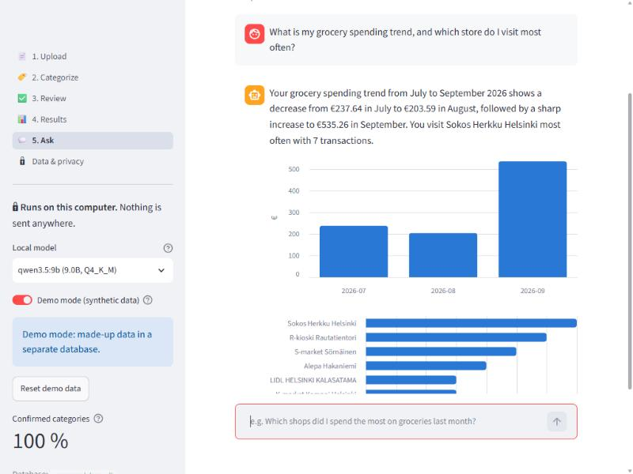
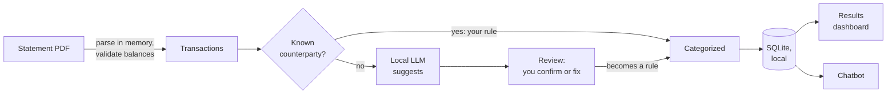
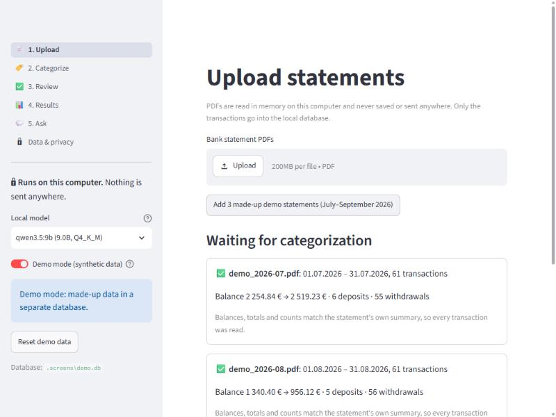
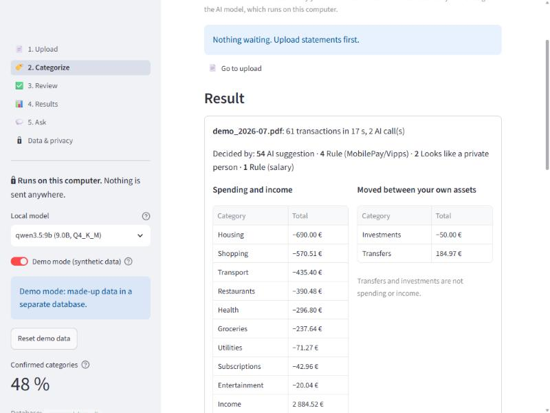
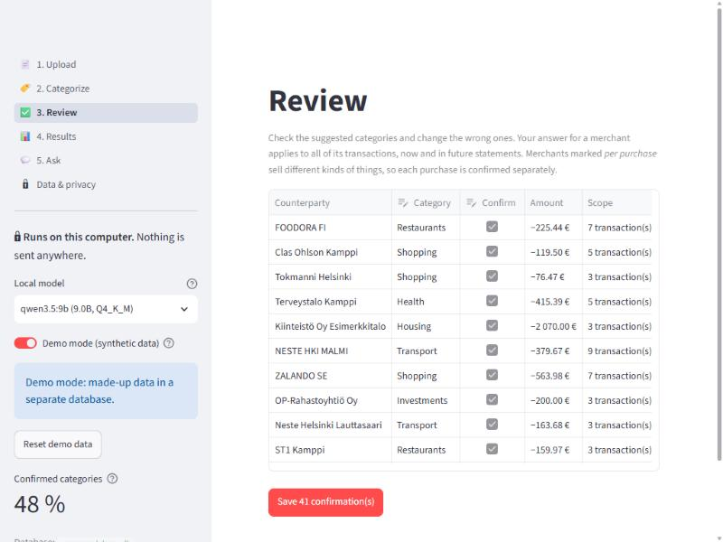
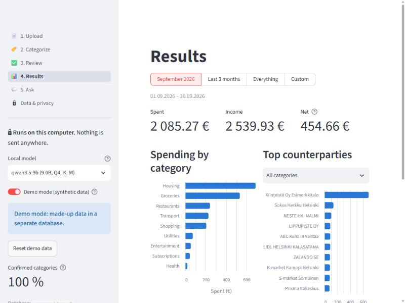
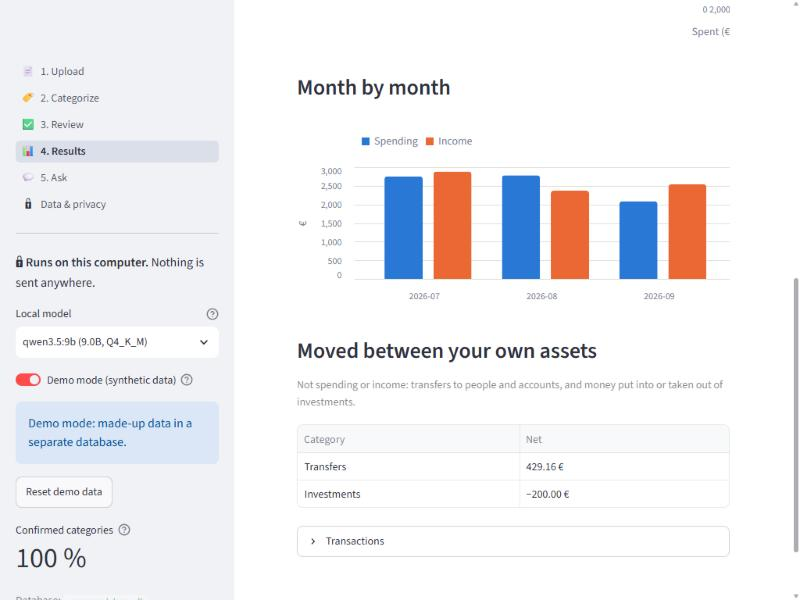
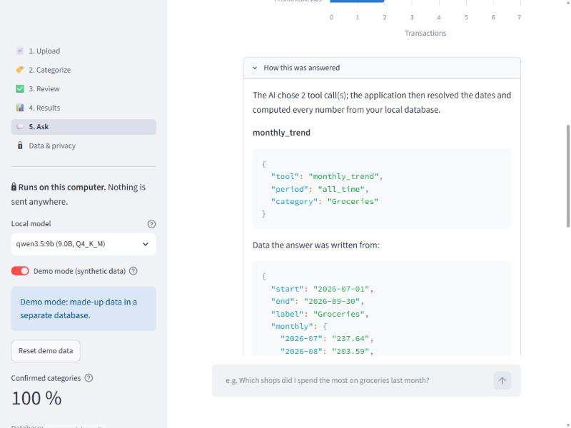
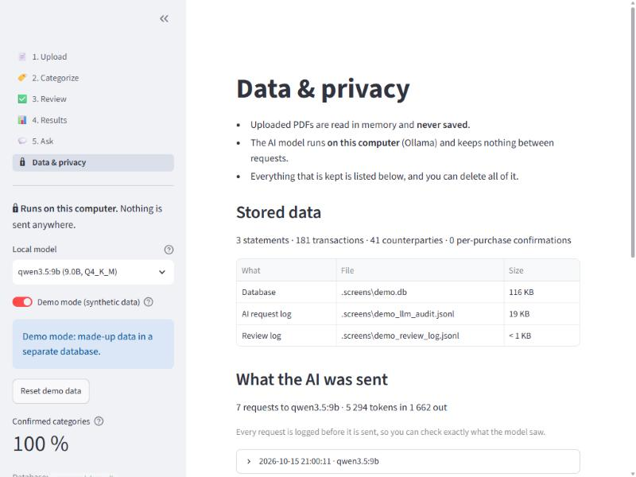

# Spending Analyzer

A privacy-first personal finance tool: it reads bank statement PDFs,
categorizes every transaction, and answers questions about your spending in plain
language.

The project is a study in using AI only where it adds value, keeping a human in
control of every decision, and measuring the result instead of guessing:

- **Deterministic where possible.** Parsing, every calculation, every date and every
  chart is plain code. The PDF parser checks its own work against the balances and
  totals printed on the statement.
- **AI suggests, the user confirms, the system remembers.** A local language model
  suggests categories for merchants it hasn't seen; the user confirms or corrects them
  once, and confirmed answers become rules that are never sent to the model again.
- **The model never does arithmetic.** In the chatbot it only picks a tool and its
  parameters, then phrases an answer from numbers the code computed.
- **Private by design.** Statements are read in memory and never stored; the model
  runs locally through [Ollama](https://ollama.com); every request to the model is
  logged so you can see exactly what it was given; one button deletes everything.
- **Measured.** Synthetic statements with known answers make categorization and
  question-routing accuracy measurable, including what did *not* work.

> Built for one bank's PDF statement layout (OP, a Finnish bank). The parser is the only
> bank-specific part; everything after it works on a common transaction model.



*All screenshots use the app's demo mode: made-up statements, no real finances.*

---

## What it does



| Step | What happens |
|---|---|
| **1. Upload** | PDFs are parsed in memory. The parser validates itself: opening balance + transactions must equal the closing balance, and deposit/withdrawal totals and counts must match the statement's summary. A statement that doesn't add up is flagged, not silently used. |
| **2. Categorize** | Each transaction is decided by the first matching step: a per-purchase confirmation, a confirmed counterparty, a fixed rule (salary, MobilePay/Vipps), a private-person heuristic, an earlier AI suggestion — and only what's left goes to the local model, in batches. |
| **3. Review** | A table of the AI's suggestions. Accept or correct each merchant once; merchants that sell different kinds of things (a fuel station that also sells food) are confirmed per purchase. A meter shows how much of your money is covered by confirmed categories. |
| **4. Results** | Spending, income and net; spending by category; top counterparties (by money or by number of visits); month by month. Transfers and investments are shown separately — moving money between your own accounts isn't spending or income. |
| **5. Ask** | "Which grocery stores did I use most last month?" — the model chooses up to three tool calls, code computes the answer, and a "How this was answered" panel shows the tool, its parameters and the data the answer was written from. |
| **Data & privacy** | What is stored, every prompt the model was sent, and "Delete all my data". |

**Demo mode** switches to a separate database with made-up statements, so the whole app
can be tried — or shown — without anyone's real finances.

### Screenshots

| | |
|---|---|
| <br>**Upload.** Each statement is validated against its own balances and totals before anything is stored. | <br>**Categorize.** 61 transactions in 17 s with 2 calls to the local model; fixed rules decide salary and MobilePay/Vipps. |
| <br>**Review.** The AI's suggestions, one row per merchant. Here it filed the St1 fuel station under Restaurants — this is where you'd correct it. | <br>**Results.** Spending, income and net; spending by category; top counterparties. No AI on this page. |
| <br>**Month by month.** Transfers and investments are kept apart: moving money between your own accounts isn't spending or income. | <br>**How this was answered.** The tool calls the model chose and the computed data its answer was written from. |
| <br>**Data & privacy.** What is stored, every prompt the model was sent, and one button to delete it all. | |

## Getting started

### Prerequisites

- **Python 3.12+**
- **[Ollama](https://ollama.com/download)** with a local model. The project was
  developed and measured with `qwen3.5:9b` (about 6.5 GB; runs on a 10 GB GPU). Any
  installed model can be chosen in the app, but the accuracy figures below are for
  that one.

### Install

```bash
git clone <this repository>
cd spending-analyzer
python -m venv .venv
```

Activate the virtual environment — Windows:

```bash
.venv\Scripts\activate
```

macOS / Linux:

```bash
source .venv/bin/activate
```

Then install the project and pull the model:

```bash
pip install -e ".[dev]"
```

```bash
ollama pull qwen3.5:9b
```

### Run the web app

```bash
streamlit run src/spending_analyzer/ui/app.py
```

It opens at <http://localhost:8501>. To try it without a bank statement, switch on
**Demo mode** in the sidebar and press **Add 3 made-up demo statements** on the Upload
page, then walk through Categorize → Review → Results → Ask.

Your own data goes to `data/transactions.db`. To keep it somewhere else:

```bash
streamlit run src/spending_analyzer/ui/app.py -- --db path/to/my.db
```

### Command-line tools

Everything the app does is also available from the terminal:

| Command | What it does |
|---|---|
| `python -m spending_analyzer.pdf_parser statement.pdf` | Parse and validate; prints only counts and the validation result |
| `python -m spending_analyzer.categorize statement.pdf` | Categorize and store |
| `python -m spending_analyzer.review statement.pdf` | Review suggestions in the terminal |
| `python -m spending_analyzer.chatbot` | Ask questions in the terminal |
| `python -m spending_analyzer.synthetic out.pdf --seed 1` | Generate a made-up statement in the real layout |
| `python tools/anonymize_structure.py statement.pdf` | Dump a statement's *layout* with all content masked (for adapting the parser without sharing data) |

### Tests and evaluations

```bash
pytest
```

The tests never call a model. The evaluations do — locally, on synthetic data:

```bash
python -m spending_analyzer.evaluate --months 3
```

```bash
python -m spending_analyzer.evaluate_router
```

## Privacy and data protection

| Data | Where it goes |
|---|---|
| Statement PDF | Read in memory, never written to disk |
| Transactions, counterparties, your confirmations | Local SQLite database (`data/`) |
| What the model sees | Local model only. Each request is logged to `data/llm_audit.jsonl` *before* it is sent and can be read on the Data & privacy page |
| Chatbot | The tool-choosing call sees only your question and a fixed prompt — never your data. The answer-writing call sees the computed numbers and always runs locally |
| Deleting | "Delete all my data" removes the database and logs |

The code also contains an optional cloud client (Claude, via the official Anthropic SDK)
to show the model layer is provider-independent. Data minimization then depends on
where the model runs: a **cloud** model would receive only unique merchant names and
transaction types — never amounts, dates, messages, account numbers, the user's name
or anyone who might be a private person (a test checks the outgoing payloads). The
cloud client is untested against the live API; the project runs fully locally.

Real data never enters version control: `data/`, PDFs, CSVs and databases are
git-ignored, and all test data is synthetic.

## Evaluation

Synthetic statements are generated in the real layout with known categories, so
accuracy can be measured exactly. The ground truth was assigned by the developer and
the merchant list is small (~40), so differences of one merchant are noise.

### Categorization (qwen3.5:9b, 3 synthetic months)

This measures a **cold start**: an empty rule book, no confirmations from the user.

| What the model is given | Correct transactions |
|---|---|
| Merchant name and transaction type | 81.3 % (152 / 187) |
| + amount, direction and message ("full context") | 81.3 % (152 / 187) |
| Fixed rules (salary, MobilePay/Vipps) and private-person heuristic | 100 % (19 / 19) |

All remaining errors come from the same 7 of ~40 merchants, and all are knowledge gaps:
the model doesn't know that Neste, ABC and St1 are fuel stations (two of them also
sell food, so their category depends on the purchase), that Motonet sells car parts
and hardware, or that Lippupiste sells event tickets. In practice that means a new
user corrects a handful of merchants once in the review, and those answers are then
always right.

What the experiments showed:

- **Thinking mode isn't worth it here:** 88.6 % vs 88.1 % without it, at 6× the time
  and 13× the output tokens.
- **More context didn't help.** Giving the model each transaction's amount, direction
  and message (possible because it runs locally) scored the same as giving it only the
  merchant name. The model didn't know that Neste, ABC or St1 are fuel stations, so the
  amount couldn't tell it fuel from food. **The bottleneck is merchant knowledge, not
  context** — which is why confirmations by the user carry the system.
- Once a merchant is confirmed it never goes to the model again: re-categorizing a
  reviewed statement takes 0 AI calls.

### Question routing (does the chatbot pick the right tool?)

| | Development set | Held-out set |
|---|---|---|
| First version | 10/14 | — |
| Parameter guide in the prompt + code guards | 13/14 | 4/6 |
| + transaction lists, several calls per question, ranking by count | **16/16** | **5/8** |

The held-out questions were never used while writing the prompt. The gap between the
two sets is the honest measure of how much the prompt is fitted to its own examples.
The remaining misses are synonyms the 9B model doesn't map to a category ("fuel",
"eating out", "pharmacies") — deliberately not patched, so the held-out number stays
meaningful.

Small, repeatable model mistakes are caught by code instead of prompt tweaks, for
example: a year the question never mentioned is dropped (the model once invented
"2023"), a category written into the wrong field is moved, and a period the model
couldn't resolve is an error rather than a silent "this month".

## Limitations and future work

- **One bank's layout.** Another bank's PDF is rejected with a clear message rather
  than half-read. A new bank needs a new parser (or a CSV reader); the rest of the
  pipeline is unchanged.
- **MobilePay/Vipps recipients are unknown.** The bank statement shows only the app,
  not who received the money, so those payments are grouped as such. Names would
  need a second source, such as the app's own history.
- **No dependent chaining in the chatbot.** Up to three *independent* tool calls per
  question; "how much did I spend at my favorite store?" (one call needing another's
  result) would need an agent loop, which a 9B local model doesn't run reliably.
- **No conversation memory.** Each question is answered on its own.
- **Merchant knowledge.** A larger model, or a web lookup for unknown merchants, would
  reduce the corrections a new user has to make.
- **Counterparty merging** ("J SILLANPAA" = "Jari Sillanpää") isn't built.

## Project layout

```
src/spending_analyzer/
  pdf_parser.py      statement PDF → transactions, with self-validation
  models.py          Transaction, Statement
  categorize.py      decision chain: confirmations → rules → local LLM
  review.py          confirm/correct suggestions (shared by CLI and web)
  store.py           SQLite: counterparties, transactions, queries
  chatbot.py         tool routing, guards, answer phrasing
  llm.py             provider-neutral LLM interface (Ollama, Claude), audit log
  privacy.py         person vs. business, card payment detection
  pipeline.py        the web app's steps, free of UI code
  synthetic.py       made-up statements in the real layout, with true categories
  evaluate.py        categorization accuracy
  evaluate_router.py chatbot routing accuracy
  ui/                Streamlit web app (one module per page)
tools/anonymize_structure.py   masked layout dump of a real statement
docs/statement-layout.md       the statement layout the parser targets
tests/                         pytest, incl. headless UI tests
```
